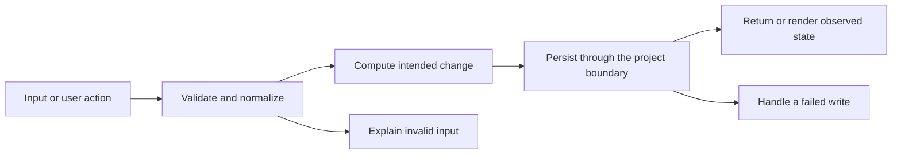

# Codebase map and reading order

[Course index](README.md)

## The problem this project solves

The shopping list persisted recipe selection and checkmarks, but quantities came only from recipe data and could not be adjusted. Storage checking was shallow. The improvement you will study is: Shoppers can edit quantities using labeled keyboard-accessible controls. Overrides persist, removal cleans up stale keys, and copied text uses the same effective quantities as the screen. Old saved selections/checkmarks are retained and malformed keys are removed.

## Data model

Shopping state contains recipeSlugs, checked and quantities. Quantity overrides are strings keyed by slug:index. An absent override uses the source recipe quantity; an explicit empty string means the shopper intentionally removed the quantity text.

An object is a named collection of fields. An array is an ordered collection of values. An id answers “which record?”; an index answers “where is it in this array right now?” Those questions are different whenever the list can be filtered, reordered or edited. Persisted data is the form that must survive a process/page restart. Derived data can be recomputed from that persisted state.

## Trace one action

1. ShoppingListPage reads shared shopping-list context.
2. Each ingredient has a stable slug:index key.
3. A labeled text input sends a quantity override to setQuantity.
4. Normalization retains only known recipe/ingredient keys.
5. The provider saves the state to localStorage.
6. Display and clipboard both use ingredientsWithQuantities.

This diagram names responsibilities, not necessarily separate files. A small browser program can keep them in app.js. A larger API spreads them across controllers, services and models. Follow the actual sequence above rather than assuming every repository has the same architecture.

## Where to read first

1. [src/store/shoppingState.ts](../src/store/shoppingState.ts): locate `normalizeShoppingState` and read its inputs, branches and return/side effects.
2. [test/shopping-state.test.ts](../test/shopping-state.test.ts): read the scenario names before the helper code.
3. The root [README](../README.md): connect setup and the larger application workflow.

## Source navigation

- [src/App.tsx](../src/App.tsx)
- [src/components/IngredientChecklist.tsx](../src/components/IngredientChecklist.tsx)
- [src/components/RecipeCard.tsx](../src/components/RecipeCard.tsx)
- [src/data/recipes.ts](../src/data/recipes.ts)
- [src/hooks/useCopy.ts](../src/hooks/useCopy.ts)
- [src/main.tsx](../src/main.tsx)
- [src/pages/HomePage.tsx](../src/pages/HomePage.tsx)
- [src/pages/RecipePage.tsx](../src/pages/RecipePage.tsx)
- [src/pages/ShoppingListPage.tsx](../src/pages/ShoppingListPage.tsx)
- [src/store/ShoppingListContext.tsx](../src/store/ShoppingListContext.tsx)
- [src/store/shoppingState.ts](../src/store/shoppingState.ts)
- [src/types.ts](../src/types.ts)
- [vite.config.ts](../vite.config.ts)

## A practical reading technique

At each function boundary, write down the value coming in, the value going out and any side effect. A side effect includes a storage write, SQL query, network request, timer registration or DOM update. If a function calls another function, inspect only that next dependency until you can finish the chosen trace. Return to unrelated files later.

For this lesson, start with: **The source ingredient says "1 cup". Change it to "2 1/2 cups" in the shopping list. Reload and copy the list: both still say "2 1/2 cups". The source recipe continues to say "1 cup". Remove the recipe and its override disappears.** Mark where the id, time, amount or other important value changes representation. For example, JSON serializes values into text; a date field may be a calendar string; SQL aggregates may return a different type from individual rows. Representation changes are common bug locations.

## Check your understanding

Without reading the solution, answer: Who owns the mutable state? Which input is untrusted? Which function first decides whether the operation is valid? What survives reload or restart? What observation would prove that the operation partially failed? Point to a source file for each answer, rather than describing a generic app from memory.
